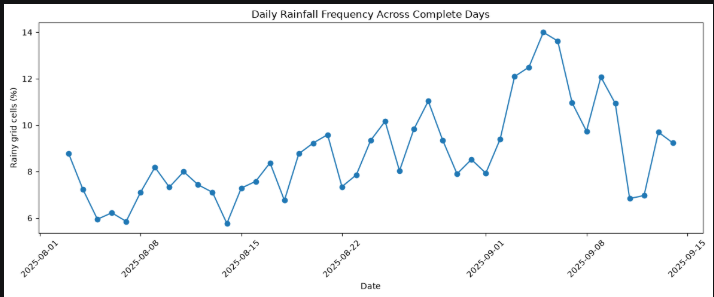
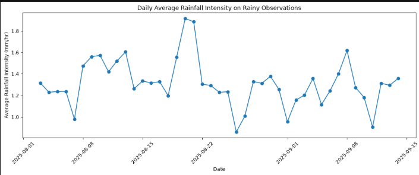
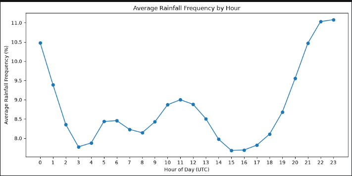
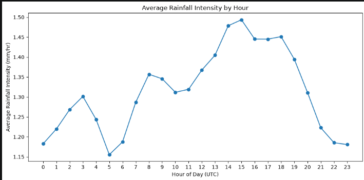
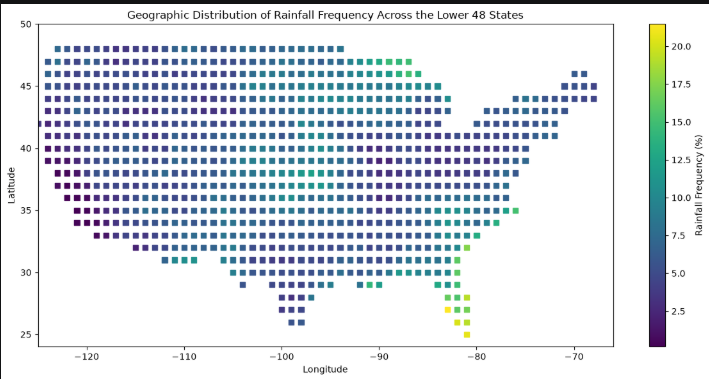
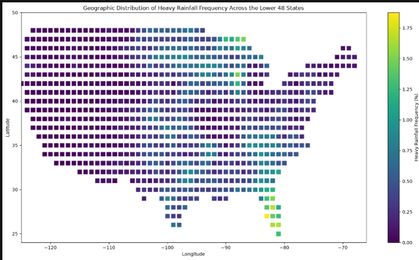

Large-Scale Analysis of Heavy Rainfall Patterns Across the United States Using NASA GPM IMERG
1. Title and Team Members
Project Title: Large-Scale Analysis of Heavy Rainfall Patterns Across the United States Using NASA GPM IMERG
Team Members:
·	Akshitha Tolupunuri
·	Saksham Saxena
·	Harini Karnati
Course: EAS 587 - Data-Intensive Computing
University: University at Buffalo
Semester: Fall 2026
2. Executive Summary
The aim of our project is to look at how the frequency of rainfall, the intensity of rainfall and the location of heavy rainfall has changed across the US from August 1 to September 14, 2025. We're using the NASA GPM IMERG Final Run V07 half-hourly rainfall data. The raw dataset contains 2,067 HDF5 files and is about 16 GB. Since the data is too large to load into memory at one time, we processed one file at a time and stored the cleaned data as Parquet files. In Phase 2, we cleaned and profiled the data and created daily, hourly, spatial, and EDA summaries. We found that only 9.9% of the sampled observations had positive rainfall and that the positive rainfall was very strongly right skewed. We defined heavy rainfall as rainfall of 5.3mm/hr or above (this is the 95th percentile of positive rainfall). September 5 had the highest daily rainfall frequency and August 20 had the highest average rainy intensity. Rainfall frequency was highest between 21:00 and 23:00 UTC and the average rainy intensity was highest between 14:00 and 18:00 UTC. Spatially, the highest rainfall and highest heavy rainfall frequency were seen in Florida and parts of the Southeast during the study period. These results give us a clear base for the larger analysis planned for Phase 3.
3. Connection to Phase 1
Our Phase 1 research question was:
How did the frequency, intensity, and geographical distribution of heavy rainfall vary in different regions of the United States from August 1 to September 14, 2025?
The research question remained the same, while the data set changed. As NASA IMERG has 30-minute intervals, and the period under analysis comprises 45 days, there should have been 2160 files. In reality, only 2067 files were downloaded, meaning that 93 files were missing.
The main difference between Phase 1 and Phase 2 was that, in Phase 1, an adequate threshold had not been selected. In Phase 2, after analysing positive rainfall distribution, the 95th percentile or 5.3 mm/hr was chosen as the threshold for heavy rainfall for this study.
The project’s findings are aimed at studying short-term trends in rainfall rather than predicting floods or insurance claims. As such, the project can be considered a precursor to further research into patterns of exposure to rainfall.
4. Data Cleaning and Processing
4.1 Profiling and Cleaning
NASA IMERG data is stored in HDF5 files. Each file represents one half-hour period. We mainly used latitude, longitude, time, and precipitation from the Grid group.
Before data cleansing, we checked the arrays' shapes, latitude and longitude ranges, precipitation, missing values, NASA _FillValue, zero rainfall, negative rainfall, time information, and daily file coverage.
One of the critical discoveries was that zero rainfall and missing rainfall are not the same. The value 0 mm/hr does not mean that there was no rain, but it indicates that there was no rain during the specific hourNASA uses _FillValue for missing or invalid values. We removed fill values and negative precipitation values but kept valid zero rainfall.
The original data is global, so we first reduced it to latitude 24 to 50 and longitude -125 to -66. This reduced each file to about 153,400 grid observations. Across 2,067 files, this represents about 317 million observations.
We converted NASA time into UTC and created datetime, date, hour, and minute.
The final processed columns were:
·	latitude
·	longitude
·	precipitation_mm_per_hr
·	datetime
·	date
·	hour
·	minute
We did not remove high rainfall values as outliers because strong rainfall is part of our research question.
4.2 Data Coverage
We checked the number of half-hour files available for each day.
·	August 1: no downloaded files
·	August 2: only 3 of 48 expected files
·	August 3 to September 14: 43 complete days
Because August 2 had very little data, final daily comparisons used only the 43 complete days.
4.3 Scalable Processing Strategy
The initial size of the data is about 16 GB, while the laptop has 16 GB of RAM, and it was not possible to load the data into a single Pandas DataFrame, since it would take too much memory.
For this reason, src/pipeline.py processes one HDF5 file at a time. Each file is cleaned and saved as a separate Parquet file before moving to the next file.
In the final processing run:
·	2,067 HDF5 files were available
·	2,064 files were newly processed
·	3 existing files were skipped
·	0 files failed
The pipeline skips files that were already processed, which makes restarting easier.
We used Parquet instead of CSV because it keeps data types, works well with large structured data, and can later be used with both Pandas and Spark.
5. Exploratory Data Analysis
Our EDA followed the main ideas of Tukey's Exploratory Data Analysis. We first looked at graphs, then used statistics to understand what we saw. We also used a log-scale view for the skewed rainfall distribution and used the median and percentiles to understand the data without depending only on the mean.
All EDA used processed data. For rainfall-distribution analysis, we used a reproducible sample of 413,400 observations with random_state = 42.
5.1 Positive Rainfall Distribution
Out of 413,400 sampled observations, 40,935 had positive rainfall. This means about 9.9% had rain and about 90.1% had zero rainfall.

Figure 1. Distribution of positive rainfall intensity.
Most positive rainfall values were small, while a smaller number were much higher. This created a strongly right-skewed distribution.

Figure 2. Positive rainfall distribution using a logarithmic x-axis.
 
The log-scale view made smaller and larger rainfall values easier to see together by not changing the original values and for better understanding of the distribution.The main positive rainfall-percentiles were as follows:
Percentile	Rainfall
50th	0.49 mm/hr
75th	1.47 mm/hr
90th	3.46 mm/hr
95th	5.30 mm/hr
99th	11.49 mm/hr

The median was 0.49 mm/hr, while the 99th percentile was about 11.49 mm/hr. This also shows that most rainfall values were small, while a few were much stronger.
We used 5.3 mm/hr, the 95th percentile of positive rainfall, as the heavy-rainfall threshold. In the full EDA sample, 2,044 observations, or about 0.49%, met this threshold.
5.2 Daily Rainfall Patterns

Figure 3. Daily rainfall frequency across the 43 complete days.
 
September 5 had the highest rainfall frequency at about 14.0% of the available grid-cell and time observations. The graph shows that rainfall frequency changed across the study period.

Figure 4. Average rainfall intensity among rainy observations by day.
 
20th August had the highest average rainfall intensity at about 1.92 mm/hr, followed by August 21 at about 1.89 mm/hr. This was different from rainfall frequency, showing that the day with rain most often was not the day with the strongest average rainfall. The highest single rainfall value was about 70.15 mm/hr on September 7. This is a maximum value from one observation and should not be confused with the daily average intensity.
5.3 Rainfall and Heavy Rainfall

Figure 5. Relationship between daily rainfall frequency and heavy-rainfall frequency.
 
The correlation between rainfall frequency and heavy-rainfall frequency was about 0.54, showing a moderate positive relationship. Days with more rainfall usually had more heavy rainfall, but the relationship was not perfect.
5.4 Hourly Patterns
 
 
Figure 6. Average rainfall frequency by UTC hour.

Figure 7. Average rainfall intensity among rainy observations by UTC hour. 
Rainfall frequency was highest mostly around 21:00 to 23:00 UTC, with the highest value around 23:00 UTC at about 11.1%. Average rainy intensity was highest mostly around 14:00 to 18:00 UTC, with the highest value around 15:00 UTC at about 1.49 mm/hr. This again showed that rainfall frequency and rainfall intensity do not have their highest values at the same time.
These results are in UTC and should not be treated as local-time results for every U.S. region.

5.5 Spatial Patterns
Our first spatial analysis used only a latitude and longitude box. This included ocean areas and some locations outside the lower 48 states. For the final analysis, we used U.S. Census state boundaries.
The original spatial summary had 1,534 bins. After filtering to the lower 48 states, 851 bins remained.

 
Figure 8. Rainfall frequency across lower-48 spatial bins.
Higher rainfall frequency appeared mainly around Florida and parts of the Southeast during the study period. This is only a result for our selected 45-day period and should not be treated as a long-term climate pattern.

 
Figure 9. Heavy-rainfall frequency across lower-48 spatial bins.
The highest spatial heavy-rainfall frequency was about 1.87%, with many higher values again around Florida and nearby southeastern areas. Maximum rainfall values were more spread across different locations, showing that repeated rainfall and the strongest single event were not always in the same places.
6. First Analytics Results
The first analytics were used to begin answering our Phase 1 research question. These are descriptive results and do not include machine learning.
6.1 Frequency and Intensity
About 9.9% of the EDA sample had positive rainfall.
At the daily level, September 5 had the highest rainfall frequency at about 14.0%. At the hourly level, rainfall was most frequent mainly around 21:00 to 23:00 UTC.
Rainfall intensity showed a different pattern. The positive rainfall median was 0.49 mm/hr, while the 95th percentile was 5.3 mm/hr and the 99th percentile was about 11.49 mm/hr.
August 20 had the highest daily average rainy intensity at about 1.92 mm/hr, while September 7 had the strongest single observation at about 70.15 mm/hr. Hourly average rainy intensity was highest mainly around 14:00 to 18:00 UTC.
These results show that rainfall frequency and rainfall intensity should be studied separately.
6.2 Heavy Rainfall
Heavy rainfall was defined as precipitation of 5.3 mm/hr or higher.
The highest daily heavy-rainfall frequencies included:
·	August 21: about 0.91%
·	August 20: about 0.82%
·	September 8: about 0.71%
·	September 7: about 0.62%
·	September 4: about 0.61%
The correlation between the daily rainfall frequency and heavy rainfall frequency was reported as 0.54. This implies that a higher number of days with increased rainfall occurrences resulted in greater levels of heavy rainfall with rainfall frequency being unable to explain heavy rainfall.
6.3 Geographic Results
After Census-boundary filtering, the spatial analysis used 851 lower-48 bins.
Rainfall frequency and heavy-rainfall frequency were higher mainly around Florida and parts of the Southeast during the study period. The strongest maximum rainfall values were more spread across different locations.
Overall, our Phase 2 results show that rainfall frequency, intensity, and location give different information. One measurement alone is not enough to describe heavy rainfall patterns.
7. Dead Ends
7.1 Simple Latitude and Longitude Filtering
Our first spatial method used only latitude and longitude limits. This was useful for quickly reducing the global dataset, but it also included ocean locations and some areas outside the lower 48 states.
Some high rainfall-frequency bins appeared over the Atlantic Ocean, so we did not use this method for the final spatial result.
What we learned: A simple geographic box is useful for reducing large data, but it is not accurate enough for final geographic analysis.
7.2 GeoPandas and Shapely
We first tried GeoPandas and Shapely for state-boundary filtering. In our Windows environment, some required library files were blocked and the libraries did not run correctly.
We changed to pyshp for reading the Census shapefile and Matplotlib paths for point-in-polygon checking.
What we learned: A simpler library can be more useful when a larger library causes environment problems.
8. Design Decisions
File-by-File Processing
Alternative: Load all files together.
Decision: Process one file at a time.
Reason: The expanded dataset is too large for the available 16 GB RAM.
Parquet Instead of CSV
Alternative: CSV.
Decision: Parquet.
Reason: Parquet keeps data types and works well with large structured data, Pandas, and Spark.
Keep Zero Rainfall
Alternative: Remove zero values.
Decision: Keep zero rainfall.
Reason: Zero is valid data and means no rain occurred.
Keep High Rainfall Values
Alternative: Remove high values as outliers.
Decision: Keep valid high rainfall values.
Reason: Heavy rainfall is part of our research question.
Heavy-Rainfall Threshold
Alternative: Select a fixed value manually.
Decision: Use the 95th percentile of positive rainfall.
Reason: This gives us a threshold based on our actual data.
Complete Days Only
Alternative: Compare every available date.
Decision: Use 43 complete days.
Reason: August 1 had no data and August 2 had only 3 files.
Census Boundaries
Alternative: Use only a rectangular latitude-longitude box.
Decision: Use Census state boundaries for final spatial results.
Reason: The rectangular area included ocean locations.
9. Reproducibility Statement
The repository contains the code needed to reproduce the Phase 2 workflow:
src/data_cleaning.py
src/pipeline.py
src/data_sampling.py
src/analytics.py
notebooks/phase2_analysis.ipynb
requirements.txt
README.md
The project uses relative paths instead of the ones specific to your computer. The 16 GB NASA dataset is not saved on GitHub, so the location of the raw HDF5 files is specified in the README.
The execution run in order is as follows:
pip install -r requirements.txt
python src/data_cleaning.py
python src/pipeline.py
python src/data_sampling.py
python src/analytics.py
The EDA notebook is then executed from notebooks/phase2_analysis.ipynb.
The sampling step has a random_state = 42, and the pipeline has error handling to ensure that one failed file does not cause the entire processing to fail.
Fresh Environment Verification
We executed a dry run of the project in a fresh environment on our teammate’s computer. We have installed the packages listed in requirements.txt, followed the repository instruction, and verified that the code uses relative paths. The necessary external data files were placed in the specified folders before executing the processing and analysis steps.
10. References
1. Tukey, John W. Exploratory Data Analysis. Addison-Wesley, 1977.
2. VanderPlas, Jake. Python Data Science Handbook. O’Reilly Media, 2016.
3. NASA Global Precipitation Measurement Mission. IMERG Version 07 documentation.
4. NASA GES DISC / NASA Earthdata.
5. U.S. Census Bureau state boundary data
